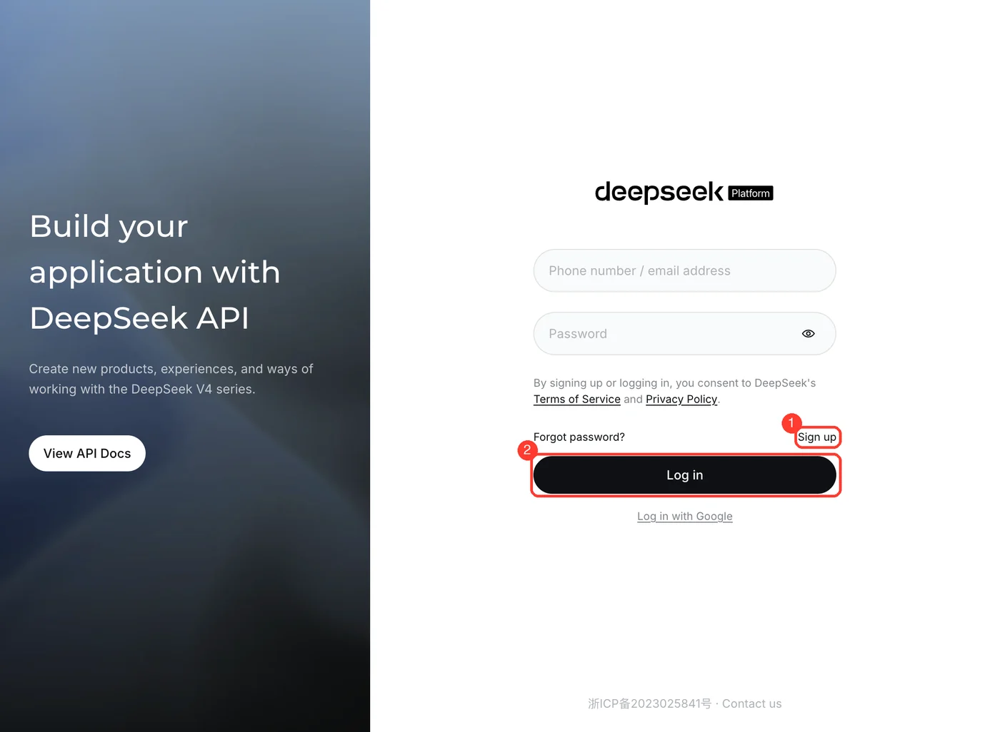
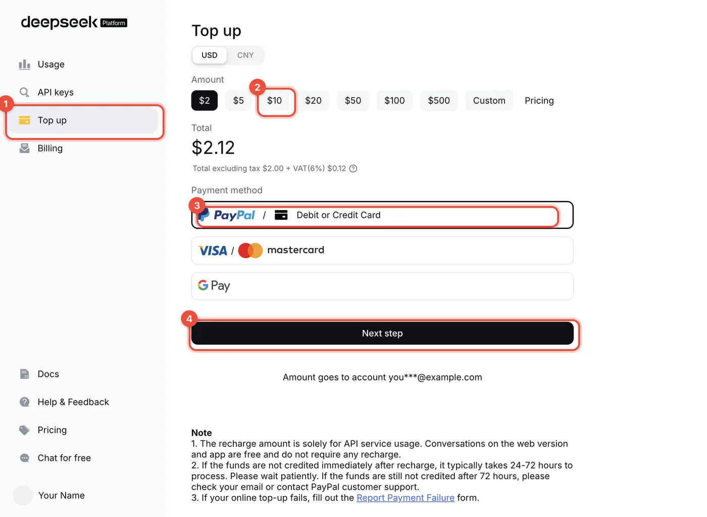
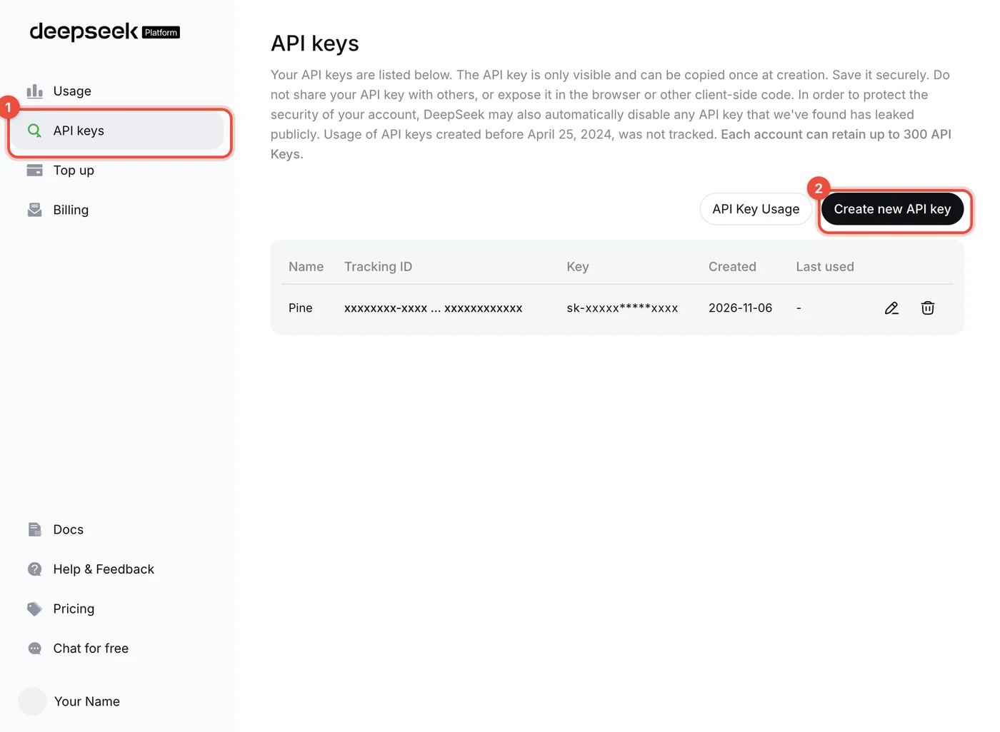
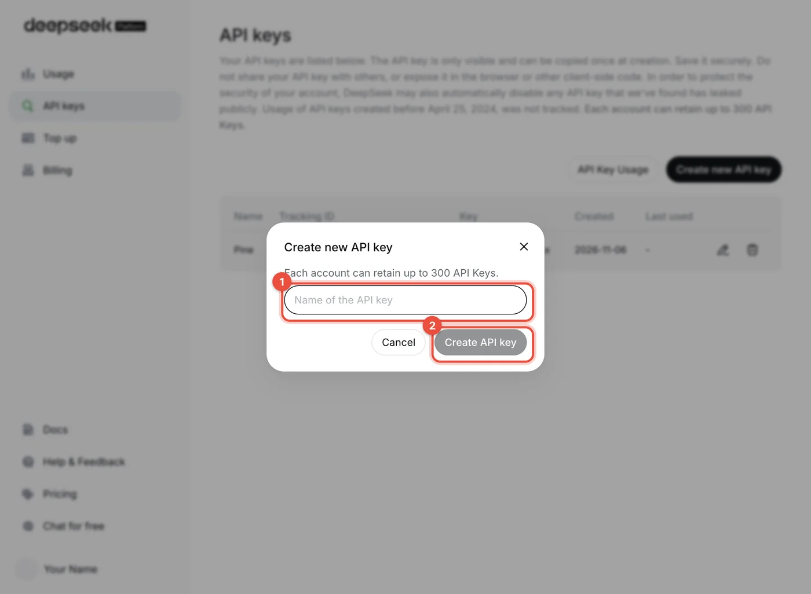
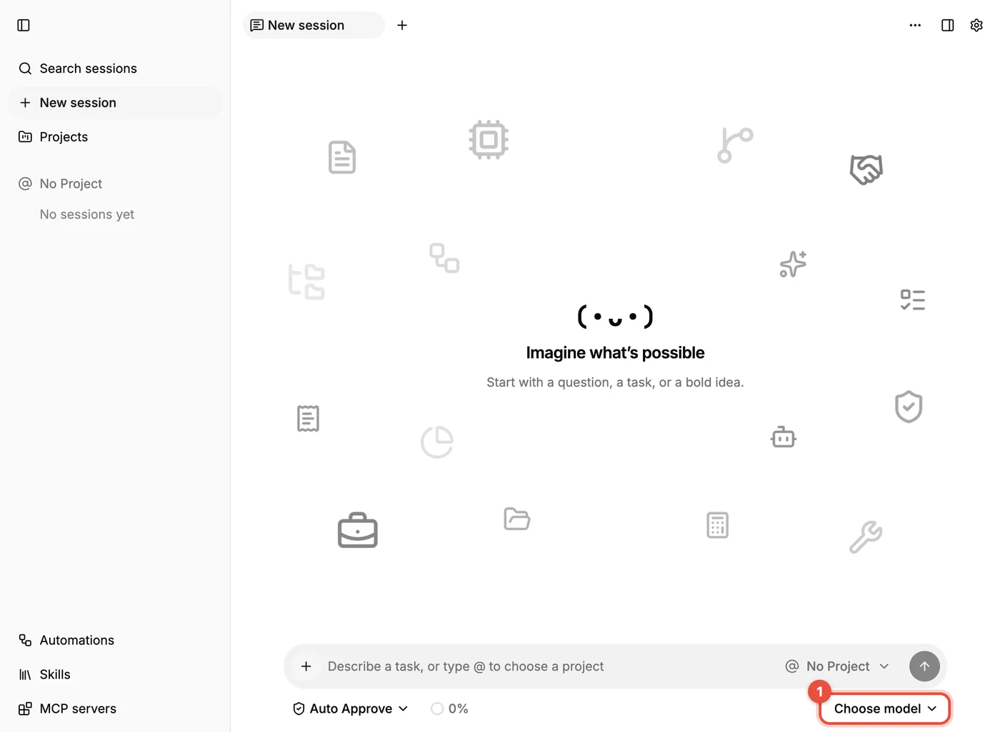
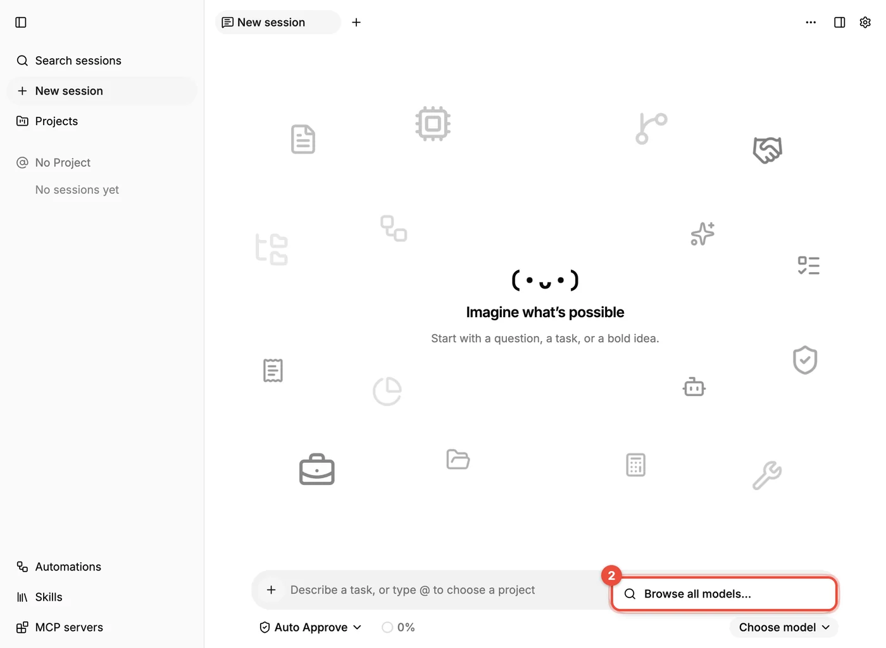
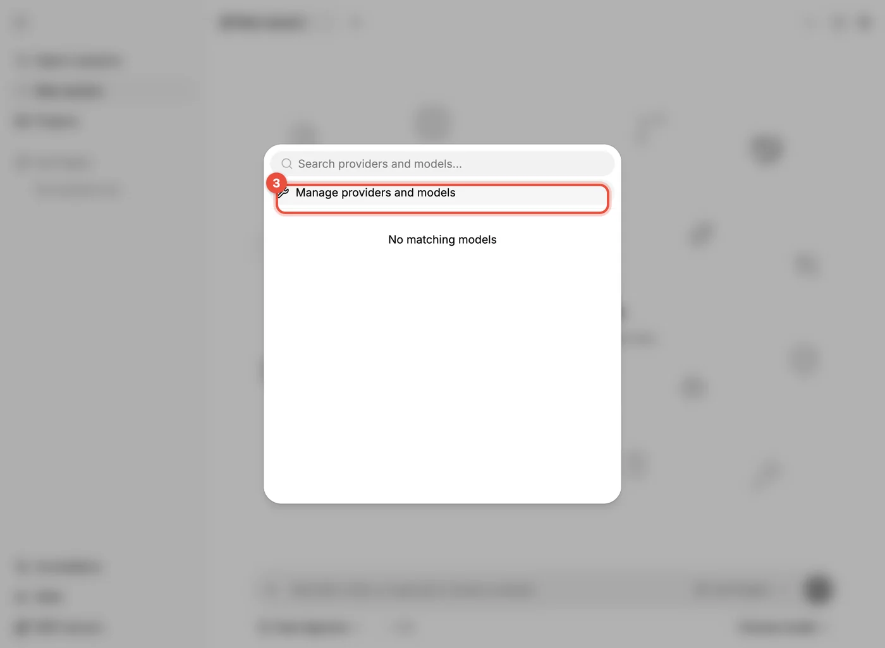
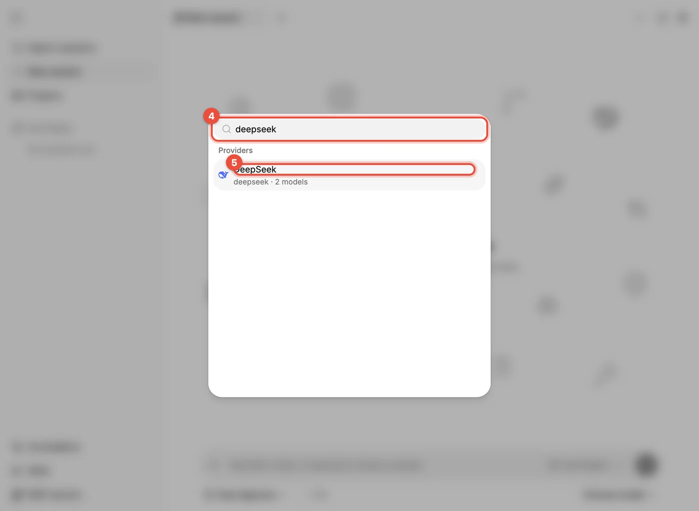
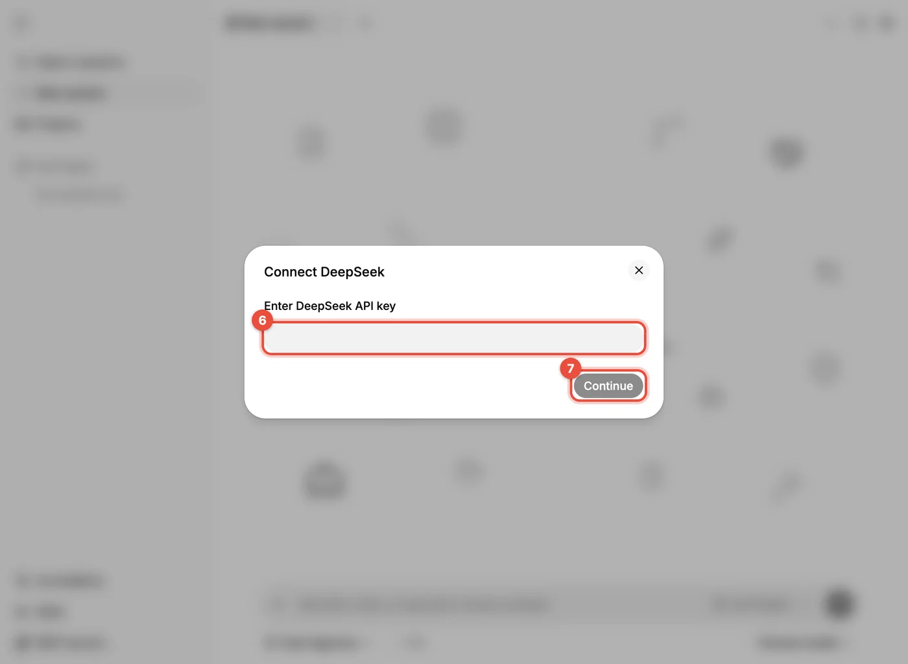

# Connect a model: DeepSeek

Without a connected model Pine can't answer anything, so this is the most important first step. This page walks through the full flow with **DeepSeek**: first get an API key on the DeepSeek platform, then enter it in Pine. Other providers work the same way; only the website where you get the API key changes to that provider's.

> [!NOTE]
> In the screenshots below, the **red boxes and numbers** mark where to click or type; the numbers are the order of the steps. Accounts, balances, and existing keys in the screenshots are redacted.

## Get an API key on the DeepSeek platform

DeepSeek's **API platform** (`platform.deepseek.com`) and its web chat (`chat.deepseek.com`) are two separate things. Web chat is free and needs no top-up; the **API is billed by usage, so you top up first and then create a key**.

**Step 1: Sign in or sign up.** Open [platform.deepseek.com](https://platform.deepseek.com). If you already have an account, enter your phone number or email and password to sign in (②); if not, click **Sign up** at the bottom right (①). You can also use "Log in with Google" below.

**Step 2: Top up.** After signing in you land in the console. Click **Top up** on the left (①), choose an amount (②; the page offers tiers starting at $2, lets you switch between USD and CNY, or lets you pick Custom), choose a payment method (③), then click **Next step** (④) and follow the page to pay.

- The page may show taxes (for example VAT); what's shown for your account is what applies.
- Credit usually arrives instantly. The page says it may take up to 24–72 hours; if it still hasn't arrived after that, follow the page to contact support.
- A small top-up is enough to start. To see each model's price, click **Pricing** on the left.

**Step 3: Create an API key.** Click **API keys** on the left (①), then **Create new API key** at the top right (②).

In the dialog, give the key an easy-to-recognize name such as `Pine` (①), then click **Create API key** (②).

After it's created, the page shows the full key (starting with `sk-`) **only this once**. Copy it and keep it safe. Once you close the dialog you can't see the full key again; if you lose it, you have to delete it and create a new one.

> [!WARNING]
> An API key is equivalent to your account balance: anyone who has it can spend your money. Don't send it to anyone, don't paste it into chats or screenshots, and don't commit it to a code repository. If you suspect a leak, go back to the API keys page, delete the key (trash icon at the end of the row), and create a new one.

## Connect DeepSeek in Pine

**Step 1: Open the model control.** Open a new session and click **Choose model** at the bottom right of the input box (①).

**Step 2: Browse all models.** Before any provider is connected, the drop-down contains only **Browse all models…** (②). Click it.

**Step 3: Manage providers.** In the window that appears, click **Manage providers and models** (③).

**Steps 4 and 5: Find DeepSeek.** Type `deepseek` in the search box at the top (④), then click **DeepSeek** when it appears (⑤).

**Steps 6 and 7: Paste the key.** In the **Connect DeepSeek** dialog, paste the API key you just copied into the input (⑥) and click **Continue** (⑦).

Once connected, DeepSeek's models appear in the model list. Go back to the session, click **Choose model**, pick a model, and send any message. If you get an answer, the connection works.

## Confirm the connection works

- It answers normally: you're done.
- It reports an authentication failure or invalid key: go back to “Get an API key on the DeepSeek platform” and check that the key was copied in full with no extra spaces; create a new one if needed.
- It reports insufficient balance: top up on the **Top up** page of the DeepSeek platform, or check your balance and usage on the **Usage** page.
- It never responds, or shows a network error: make sure your network can reach `platform.deepseek.com`; if needed, set up a proxy and restart Pine.

## Tips

- DeepSeek currently offers mainly `deepseek-flash` (fast and cheap) and `deepseek-v4-pro` (more capable). For the latest model names and prices, see the [DeepSeek API docs](https://api-docs.deepseek.com/). Pine's model catalog updates with each release, and the names you see in the list are the ones Pine knows.
- Get the flow working with a cheaper model first, and switch to a stronger one when you need it.
- **Context usage** at the bottom of the input box shows this session's cost and lets you set a **Session cost limit**; when the limit is reached, the session stops automatically.
- If you use a self-hosted gateway or a third-party aggregator that isn't in the built-in list, choose **Add custom model** in the same window and fill in the endpoint address (for example DeepSeek's OpenAI-compatible address `https://api.deepseek.com`), the key, and the model name.
- To use the same key on several computers, create one key per computer (for example `Pine Mac` and `Pine Windows`) so you can disable them individually.
