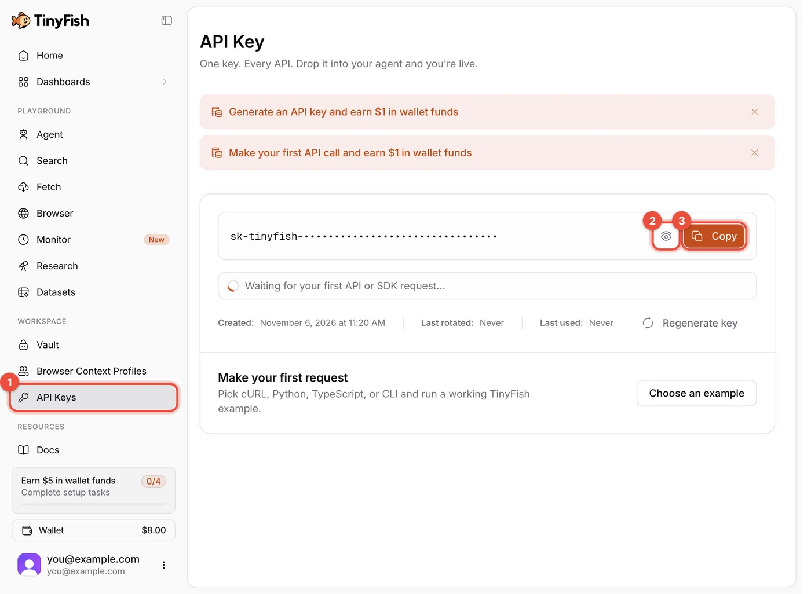
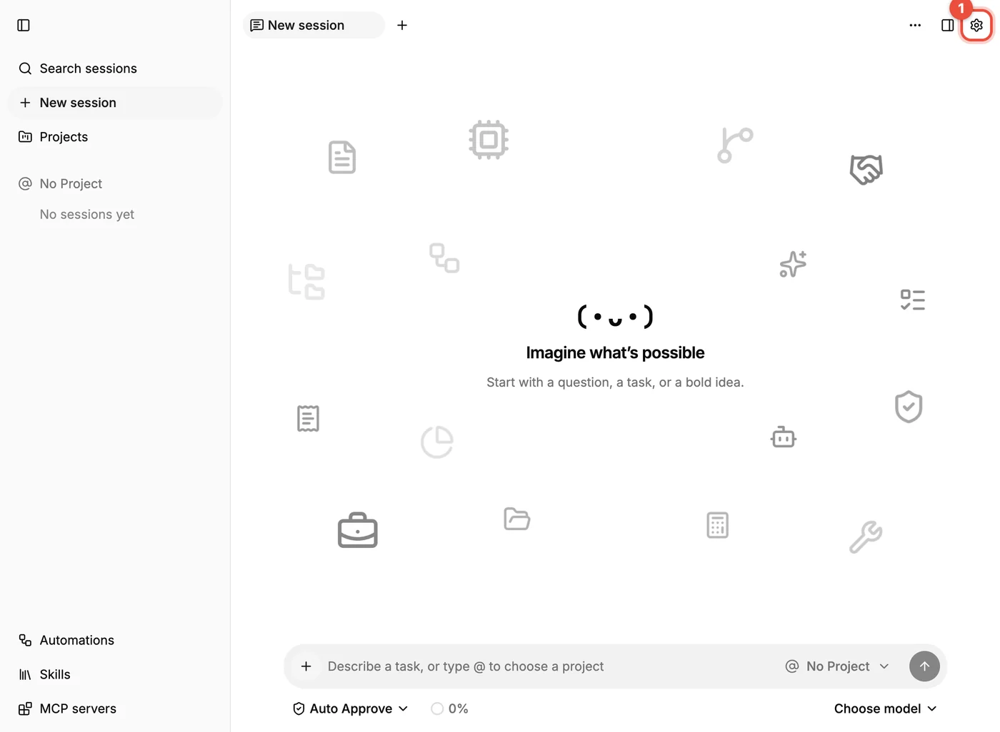
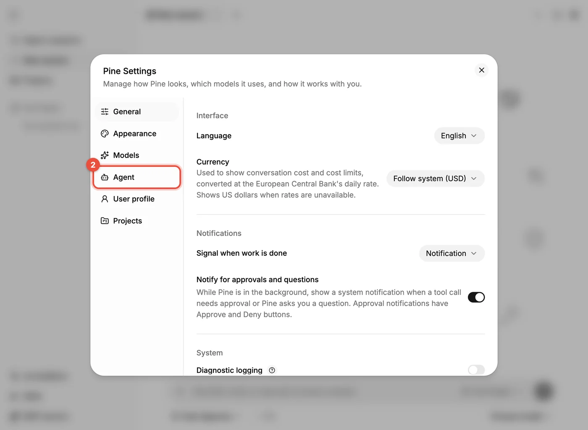
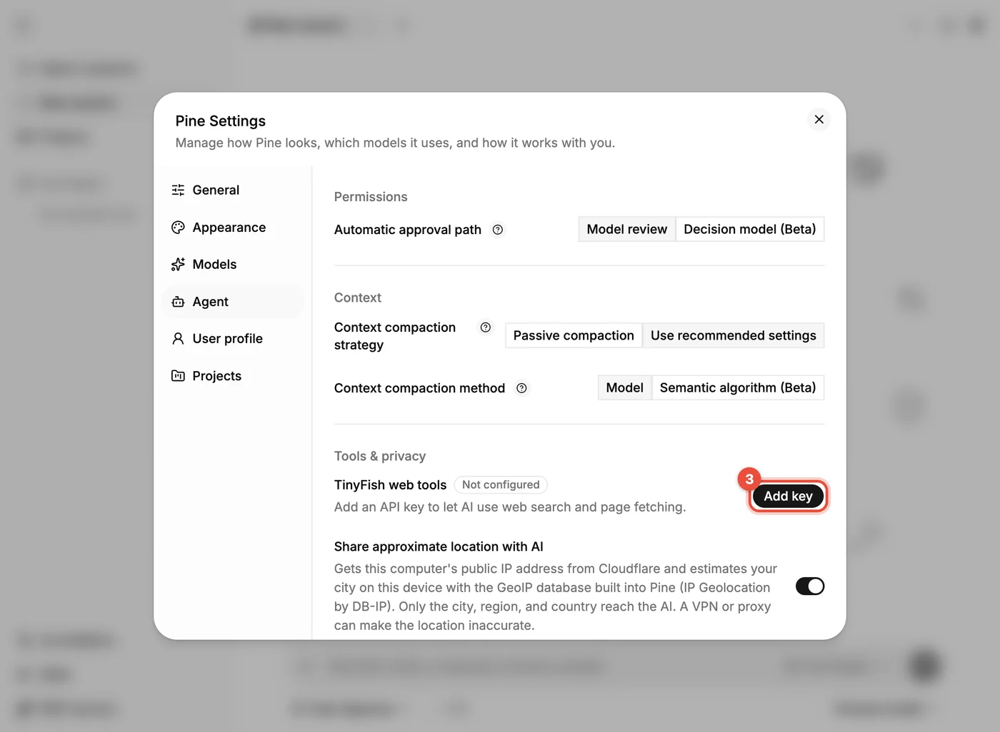
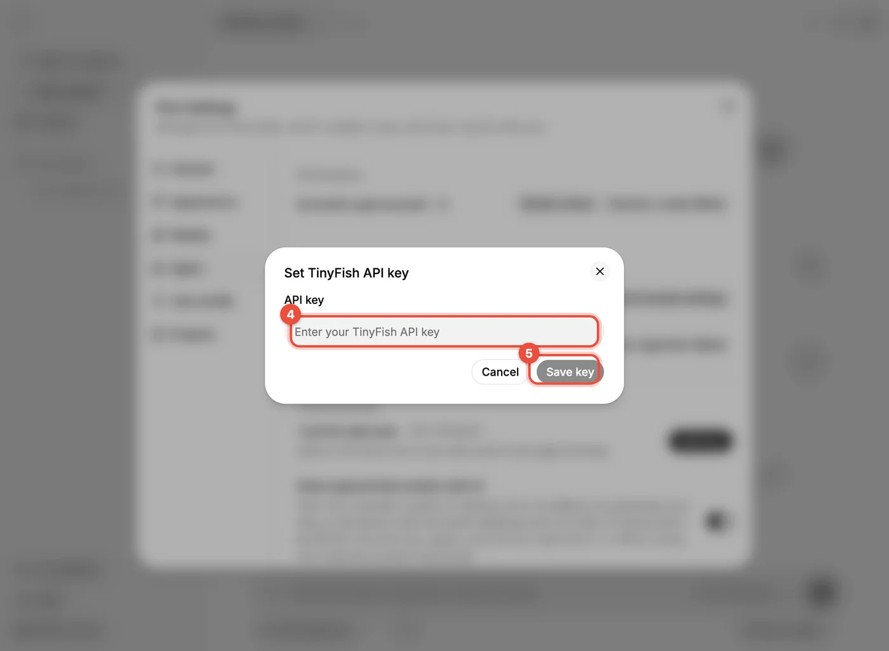

# Web search and fetching (TinyFish)

Models can't browse the web on their own. To let Pine's AI **search the web and read page contents**, you also need a **TinyFish** API key. This step is optional, but strongly recommended.

**Step 1: Sign up and sign in**

- Open [agent.tinyfish.ai](https://agent.tinyfish.ai).
- You can sign up with GitHub, Google, Microsoft, an X account, or email.
- If a cookie notice appears at the bottom of the page, choose according to your preference.

**Step 2: Skip the onboarding**

- A new account lands on a "Connect TinyFish" onboarding page that asks you to copy a "setup prompt" to some AI agent.
- **Pine doesn't need this step**; just click **Skip setup** at the top right.

> [!WARNING]
> The setup prompt on that onboarding page contains your full API key. Don't screenshot or share it.

**Step 3: View and copy the key**

- Click **API Keys** on the left (①). A new account gets a key automatically, hidden by default.
- Click the eye icon (②) to reveal it.
- Click **Copy** (③) to copy it.

**Step 4: Enter it in Pine**

- Click the gear **Open Pine settings** at the top right of Pine (①):

Click **Agent** on the left (②):

Scroll to **Tools & privacy**, find **TinyFish web tools** (currently *Not configured*), and click **Add key** (③):

In the **Set TinyFish API key** dialog, paste the key (④) and click **Save key** (⑤):

After saving, the status changes to **Configured**, and the AI can use web search and page fetching. Try it: in a session, ask "Search for today's news about something and summarize it."

- TinyFish states that Search and Fetch have a free allowance, with a requests-per-minute limit on the free tier. For exact allowances and prices, see the [TinyFish docs](https://docs.tinyfish.ai/search-api) and its pricing page.
- To change the key later, go back to the same place and click **Change key**.
- The same security rule as any API key applies: don't share it. If it leaks, click **Regenerate key** on TinyFish's API Keys page and enter the new key in Pine.
