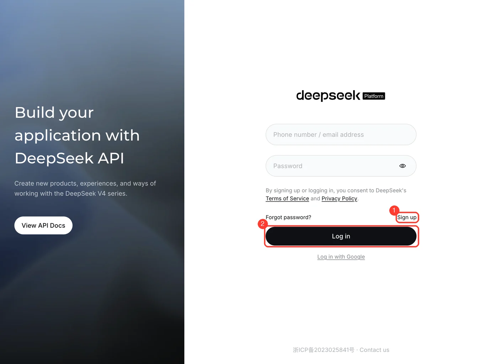
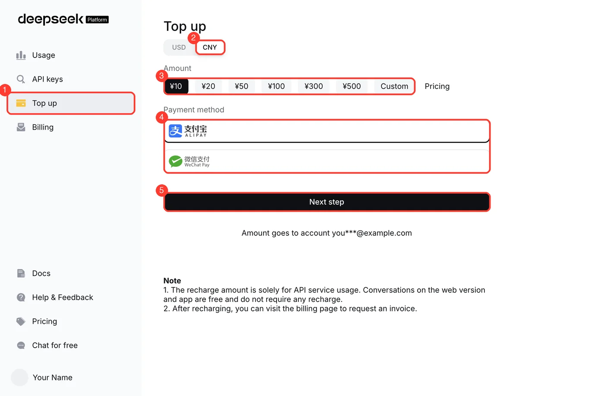
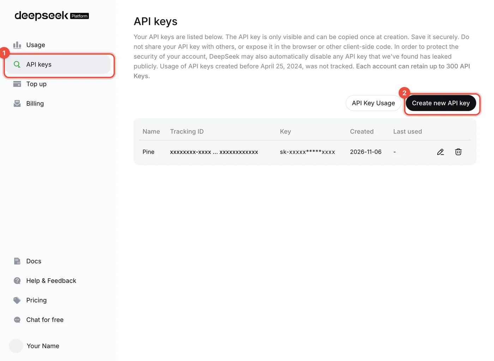
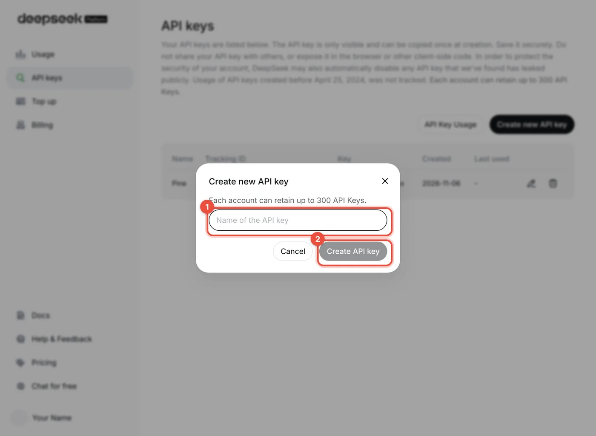
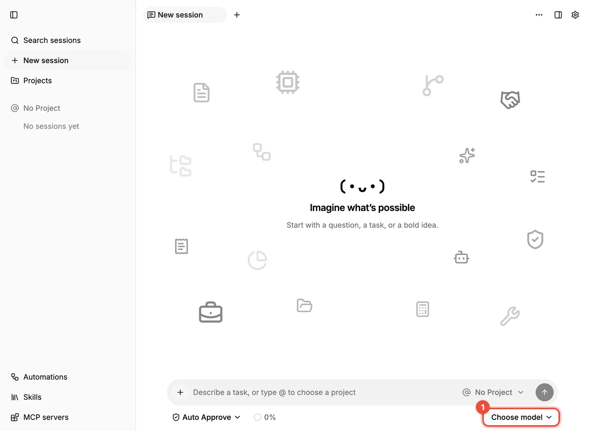
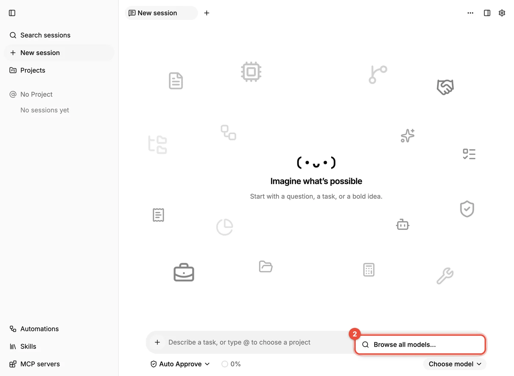
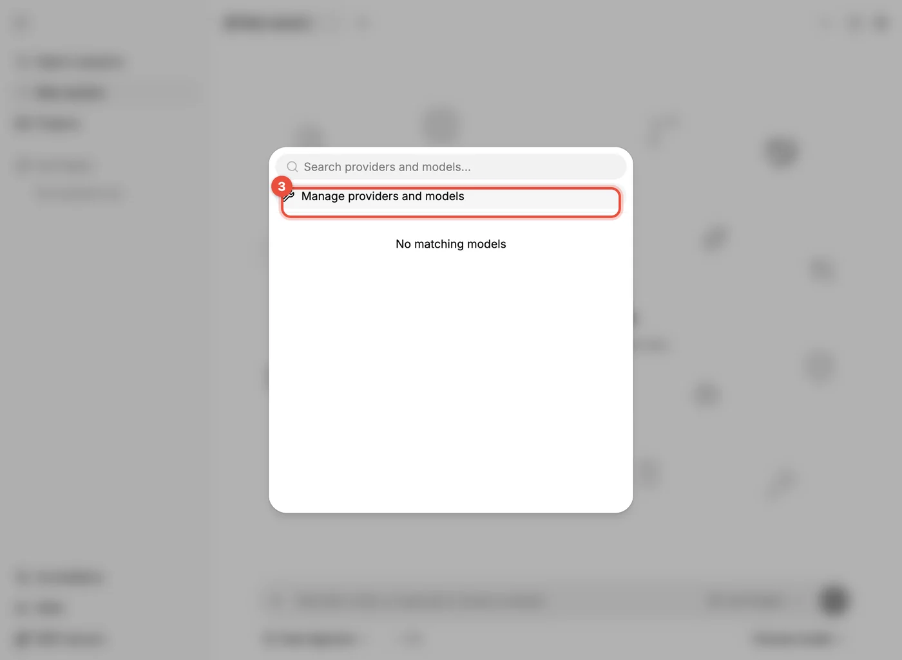
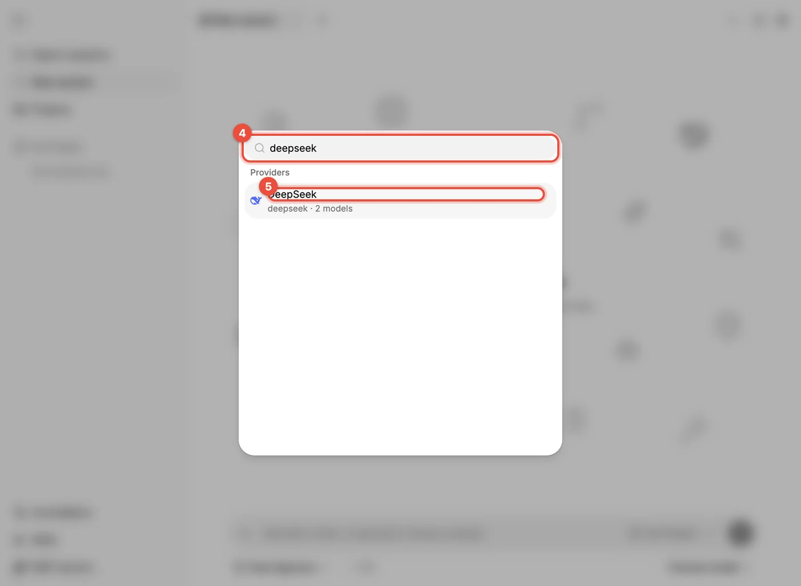
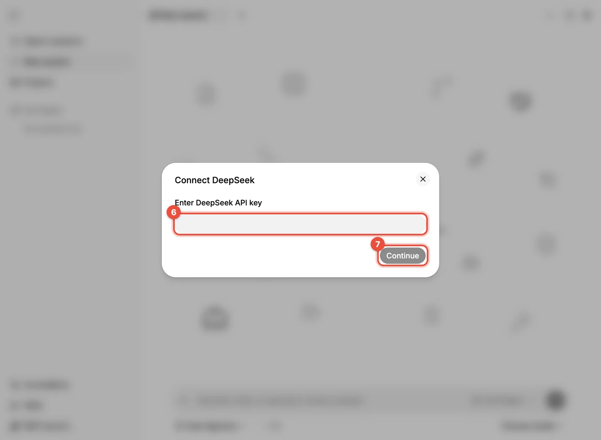

# 连接模型：DeepSeek

没有连接模型时，Pine 无法回答问题，所以这是首次使用最重要的一步。本页用 **DeepSeek** 走一遍完整流程：先在 DeepSeek 平台拿到 API Key，再填进 Pine。其他提供商的流程相同，只是获取 API Key 的网站换成对应服务商的。

> [!NOTE]
> 下文截图里的**红框和数字**表示该步要点击或填写的位置，数字就是操作顺序。截图中的账号、余额和已有 Key 已做脱敏。

## 在 DeepSeek 平台获取 API Key

DeepSeek 的 **API 平台**（`platform.deepseek.com`）和它的网页聊天（`chat.deepseek.com`）是两套东西：网页聊天免费，不需要充值；**API 按用量计费，要先充值，再创建 Key**。

**第 1 步：登录或注册**

- 打开 [platform.deepseek.com](https://platform.deepseek.com)。
- 已有账号：输入手机号或邮箱和密码登录（②）。
- 没有账号：点右下的 **Sign up**（①）注册；也可以用下方的 "Log in with Google"。

**第 2 步：充值**

- 登录后进入控制台，点左侧 **Top up**（①）。
- 如果页面顶部有 **USD / CNY** 的币种切换，选 **CNY**（②）。国内账号可能没有这个切换，直接就是人民币。
- 选择金额（③，¥10 起，也可以选 Custom 自定义）。
- 选择**支付宝（Alipay）或微信支付（WeChat Pay）**（④），再点 **Next step**（⑤），按页面提示完成支付。

- 页面上具体有哪些金额档位和支付方式，以你的账户实际显示为准。
- 到账通常是即时的；如果没有立刻到账，页面注明最长可能需要 24–72 小时，超过时间仍未到账，按页面提示联系支持。
- 充值后可以在左侧 **Billing** 页面申请发票。
- 刚开始试用，充小额即可。想了解各模型的价格，点左侧的 **Pricing**。

**第 3 步：创建 API Key**

- 点左侧 **API keys**（①），再点右上的 **Create new API key**（②）。

在弹出的对话框里给 Key 起一个好认的名字，比如 `Pine`（①），然后点 **Create API key**（②）。

创建后，页面会**只显示这一次**完整的 Key（以 `sk-` 开头），点复制并保存好。关掉对话框后就再也看不到完整内容了，丢了只能删除重建。

> [!WARNING]
> API Key 等同于你账户的余额：任何人拿到它都能花你的钱。不要发给别人，不要贴在聊天或截图里，也不要提交到代码仓库。怀疑泄露时，回到 API keys 页面删除这个 Key（行末的垃圾桶图标）并重新创建。

## 在 Pine 里连接 DeepSeek

**第 1 步：打开模型控件**

- 打开一个新会话，点输入框右下角的 **选择模型（Choose model）**（①）。

**第 2 步：浏览全部模型**

- 还没有连接任何提供商时，下拉里只有 **浏览所有模型…（Browse all models…）**（②），点它。

**第 3 步：管理提供商**

- 在弹出的窗口里点 **管理服务或模型（Manage providers and models）**（③）。

**第 4、5 步：找到 DeepSeek**

- 在顶部搜索框（④）输入 `deepseek`。
- 点击出现的 **DeepSeek**（⑤）。

**第 6、7 步：粘贴 Key**

- 在 **连接 DeepSeek（Connect DeepSeek）** 对话框里，把刚才复制的 API Key 粘贴到输入框（⑥）。
- 点 **继续（Continue）**（⑦）。

连接成功后，DeepSeek 的模型会出现在模型列表里。回到会话，点 **选择模型（Choose model）** 选一个模型，随便发一句话，收到回答就说明连接成功。

## 确认连接可用

- 能正常回答：完成。
- 提示认证失败、Key 无效：回到“在 DeepSeek 平台获取 API Key” 检查 Key 是否完整复制、有没有多出的空格，必要时重新创建。
- 提示余额不足：到 DeepSeek 平台的 **Top up** 页面充值，或在 **Usage** 页面查看余额与用量。
- 一直无响应或网络错误：确认网络能访问 `platform.deepseek.com`，必要时配置代理后重启 Pine。

## 使用提示

- DeepSeek 目前主要有两类模型：
  - `deepseek-flash`：速度快、便宜。
  - `deepseek-v4-pro`：能力更强。
- 官方的最新模型名与价格见 [DeepSeek API 文档](https://api-docs.deepseek.com/)。Pine 的模型目录随版本更新，列表里看到的名字以 Pine 为准。
- 先用较便宜的模型把流程跑通，需要更强能力时再切换。
- 在输入框底部的 **上下文占用（Context usage）** 里可以看到本次会话的费用，并设置 **会话成本上限（Session cost limit）**（会话费用上限），到达上限会自动停止。
- 如果你使用的是自建网关或第三方聚合服务，不在内置列表里，可以在同一个窗口选择 **添加自定义模型（Add custom model）**，填写接口地址（例如 DeepSeek 的 OpenAI 兼容地址 `https://api.deepseek.com`）、Key 和模型名。
- 同一个 Key 想在多台电脑上用，建议为每台电脑分别创建一个 Key（比如 `Pine Mac`、`Pine Windows`），方便单独停用。
