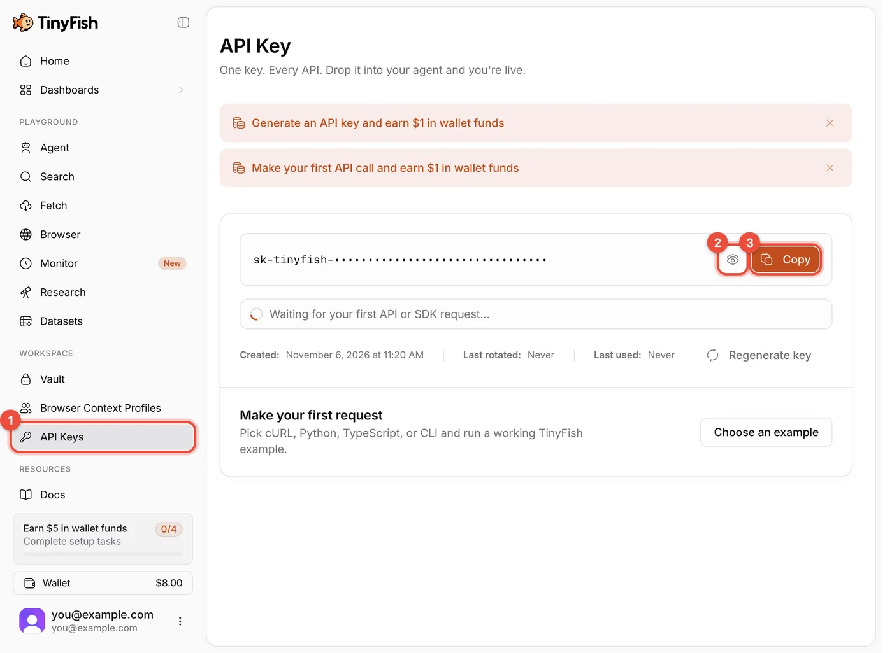
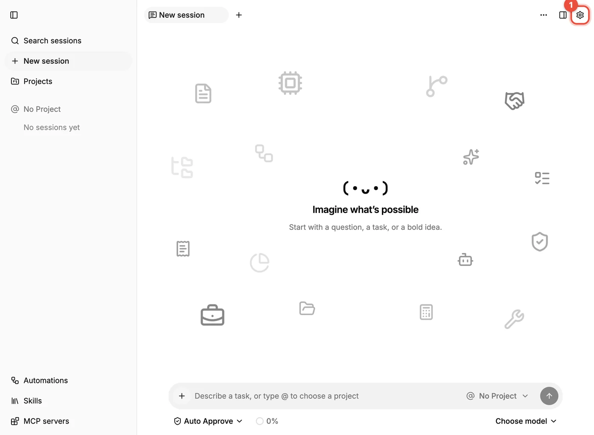
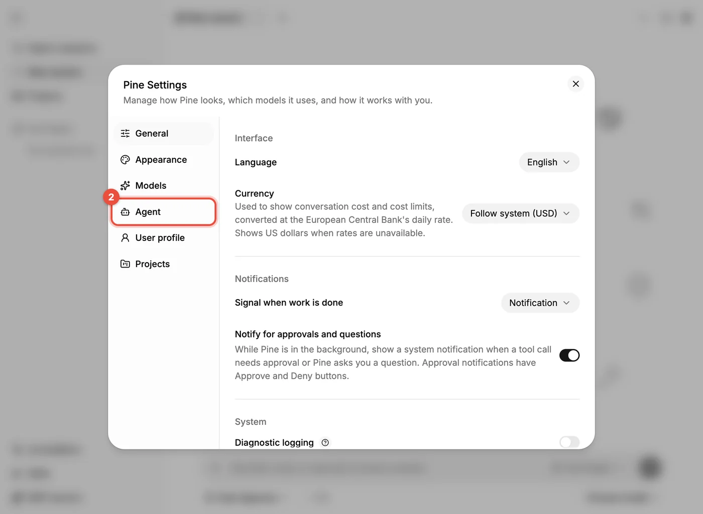
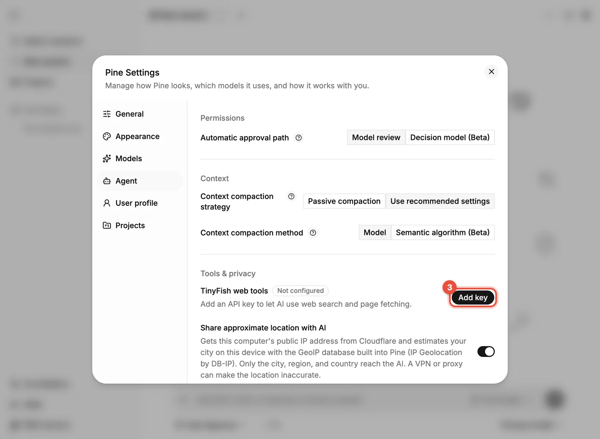
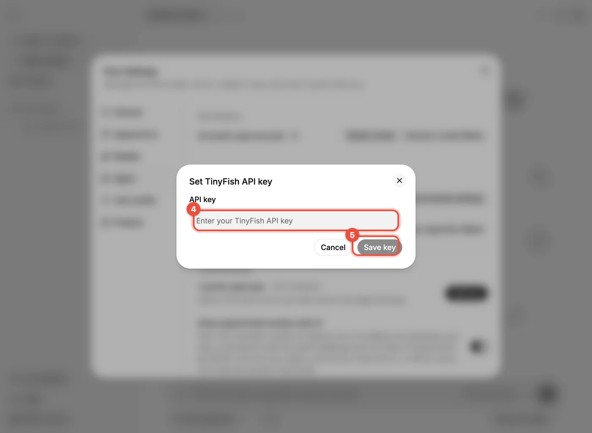

# 网页搜索与抓取（TinyFish）

模型本身不能上网。要让 Pine 的 AI 能**搜索网页、读取网页内容**，需要再配置 **TinyFish** 的 API Key。这一步可选，但强烈建议完成。

**第 1 步：注册并登录**

- 打开 [agent.tinyfish.ai](https://agent.tinyfish.ai)。
- 可以用 GitHub、Google、Microsoft、X 账号或邮箱注册。
- 如果页面底部弹出 cookie 提示，按你的偏好选择即可。

**第 2 步：跳过引导**

- 新账号登录后会进入 "Connect TinyFish" 引导页，让你把一段 "setup prompt" 复制给某个 AI 代理。
- **Pine 不需要这一步**，直接点右上角的 **Skip setup**。

> [!WARNING]
> 这个引导页里的 setup prompt 包含你的完整 API Key，不要截图或分享。

**第 3 步：查看并复制 Key**

- 在左侧点 **API Keys**（①）。新账号会自动生成一个 Key，默认是隐藏的。
- 点眼睛图标（②）显示 Key。
- 点 **Copy**（③）复制。

**第 4 步：填进 Pine**

- 点 Pine 右上角的齿轮 **打开 Pine 设置（Open Pine settings）**（①）：

在左侧点 **智能体（Agent）**（②）：

滚动到 **工具与隐私（Tools & privacy）**，找到 **TinyFish 网络工具（TinyFish web tools）**（当前为 *未配置（Not configured）*），点 **添加密钥（Add key）**（③）：

在 **设置 TinyFish API 密钥（Set TinyFish API key）** 对话框里粘贴 Key（④），点 **保存密钥（Save key）**（⑤）：

保存后状态变为 **已配置（Configured）**，AI 就可以使用网络搜索和网页抓取了。试一下：在会话里问"搜索一下今天的某条新闻并总结"。

- 官方说明 TinyFish 的 Search 与 Fetch 有免费额度，免费档有每分钟请求数限制，具体额度和价格以 [TinyFish 文档](https://docs.tinyfish.ai/search-api)和定价页为准。
- 之后想更换 Key，回到同一位置点 **更改密钥（Change key）**。
- 与 API Key 的安全要求相同：不要外传。如果 Key 泄露，在 TinyFish 的 API Keys 页面点 **Regenerate key** 重新生成，再把新 Key 填进 Pine。
